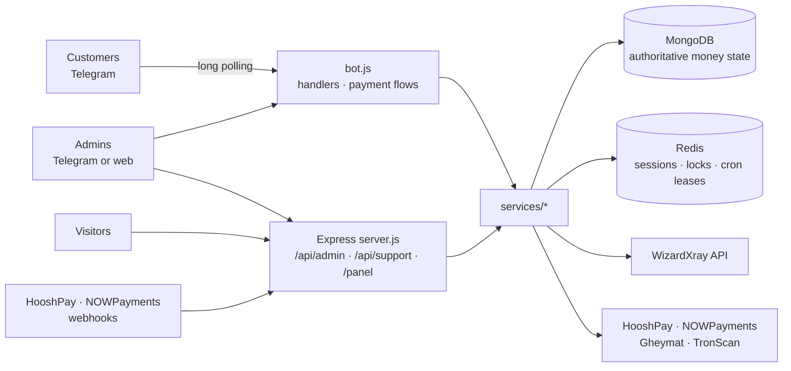

# SWIFT VPN Bot

A Telegram bot for selling VPN (VLESS) subscriptions. Customers fund a wallet, buy a plan, and receive a
connection link and QR code that the bot provisions automatically on a WizardXray panel. Admins manage
everything from Telegram or a web dashboard. A public storefront shows live plans and hands customers
over to the bot.

> The customer-facing bot and storefront are in **Persian (RTL)**. The Next.js admin dashboard
> (`/panel`) is English; the original vanilla-JS dashboard (files kept on disk, still served as `/index.html`) has Persian and English.

## Features

| Area | What is included |
|---|---|
| **Customers (Telegram)** | Buy a plan from a live catalog, top up the wallet, manage services (usage, link, QR, extend time/data, enable/disable, delete), one free trial per account, profile, guide, support relay |
| **Payments** | **HooshPay** online card-to-card, **NOWPayments** hosted TRON invoices. Every credit is signature-verified, idempotent and crash-safe ([details](docs/payments.md)) |
| **Provisioning** | WizardXray API v1: create, status, change link, extend time/data, delete. Ambiguous results are never replayed; definitive failures refund exactly once |
| **Admin** | Telegram panel and two web dashboards over one audited service layer: users, wallet credit/debit, block, per-user messages, VPN services, payments and recovery, plans, broadcasts, analytics, audit log ([details](docs/admin.md)) |
| **Money Flow Sentinel** | Traces money from payment to service, reconciles every wallet against its ledger and explains each inconsistency. It never changes money ([details](docs/sentinel.md)) |
| **Storefront** | Public Persian page with live plans, light/dark theme and an order review that continues in Telegram. There is no web checkout ([details](docs/storefront.md)) |
| **Operations** | Health probes, structured logs, recovery crons, preflight script, opt-in mock-test harness |

**Optional, legacy and external pieces**

| Item | Status |
|---|---|
| WizardXray panel, HooshPay, NOWPayments, Gheymat (USDT/IRT quote) | External services you configure |
| Direct TRX wallet scanner, manual bank-receipt confirmation | Legacy: only finish invoices created earlier; not offered in the top-up menu |
| NOWPayments custody and payouts | Optional; needs `NOWPAYMENTS_EMAIL` / `NOWPAYMENTS_PASSWORD` |
| Mock tests | Opt-in (`MOCK_TESTS_ENABLED=true`) |

## Architecture



One Node.js process runs everything. Express starts first so the health probes respond, then MongoDB
and Redis connect, then the TRX scanner and the recovery crons start, and Telegram polling starts last,
once every update handler is registered. MongoDB is mandatory and must be ready (indexes included)
before polling starts; Redis is never authoritative for money. Because the bot uses long polling, **run exactly one replica**.

## How it works

**Buy a service.** `🛒 خرید سرویس` → choose a duration → choose a plan → confirm. The plan price is
debited atomically from the wallet, the bot creates the service on the panel, and the link and QR
code are sent. If the panel definitively rejects the order the wallet is refunded once; if the
outcome is unknown the debit is held for admin review and never replayed.

**Top up the wallet.** `💰 افزایش موجودی` → HooshPay (online card-to-card) or crypto (NOWPayments
TRON) → enter an amount in Toman → pay → the wallet is credited only after the provider's signed
callback is verified.

**Manage services.** `📦 سرویس‌های من` → pick a service → view usage, change the link, get the QR,
extend time or data, enable/disable or delete it. `🎁 سرویس تست` gives one free trial per account.

**Admin.** Send `/admin` (or `/panel`) as an allow-listed admin, or open
`<WEBHOOK_BASE_URL>/panel` (`/next-panel`, `/panel-next` and `/admin` redirect there) and sign in with your Telegram ID; the bot sends a one-time code.

## Quick start

**Requirements:** Node.js 20+, MongoDB, Redis.

```bash
git clone <repository-url>
cd SWIFT-VPN-Bot
npm install
cp .env.example .env      # fill in every required value
npm run preflight         # validates configuration and probes the services
npm run build             # builds the /panel dashboard and the storefront
npm start                 # bot + web server
```

For production run `npm run build` first: `/panel` is served from that build, and without the
storefront build `/` falls back to a static page. The bot itself does not depend on the build.

### Configuration

Set the variables in `.env` (git-ignored) or in your host's secret store; never commit real values.
Required variables:

| Variable | Purpose |
|---|---|
| `BOT_TOKEN` | Telegram bot token |
| `ADMINS`, `GROUP_ID` | Admin Telegram user IDs; admin group chat ID (negative) |
| `MONGO_URL`, `REDIS_URL` (or `REDIS_HOST`/`REDIS_PORT`) | Datastores |
| `WIZARD_API_URL`, `VPN_API_KEY` | WizardXray panel |
| `HOOSHPAY_API_KEY`, `HOOSHPAY_WEBHOOK_SECRET` | HooshPay |
| `NOWPAYMENTS_API_KEY`, `NOWPAYMENTS_IPN_SECRET` | NOWPayments |
| `WEBHOOK_BASE_URL` | Public HTTPS origin, no trailing slash |
| `TRX_WALLET` | TRON address for the legacy direct-TRX flow |

The full reference, with defaults and optional settings, is in
[docs/configuration.md](docs/configuration.md); the annotated template is
[`.env.example`](.env.example).

## Development and testing

| Command | Purpose |
|---|---|
| `npm start` | Run the bot and web server (`node bot.js`) |
| `npm run preflight` | Validate configuration and connectivity |
| `npm test` | Unit and integration suites (`node --test`) |
| `npm run check:sensitive` | Scan tracked files for card numbers, tokens, emails and other sensitive values (never prints them) |
| `npm run check:context` | Check that paths, scripts and links named in `CLAUDE.md`, `.claude/` and the docs still exist |
| `npm run build` | Build `/panel` and the storefront |
| `npm run build:guide-images` | Redraw the top-up guide images (needs Chrome; the images are committed) |
| `npm run admin:dev` / `npm run storefront:dev` | Next.js dev servers (ports 3100 / 3101) |
| `npm run test:e2e` / `npm run test:e2e:store` | Browser suites (need Chrome) |

DB-backed suites need a throwaway MongoDB (`TEST_MONGO_URL`, name must contain `test`). Without one
they are **skipped, not failed**: a green run with skips means those money-path assertions did not
run. See [docs/testing.md](docs/testing.md).

Commit messages follow the Conventional Commits style used in the history (`feat:`, `fix:`,
`docs:`, `test:`). Run `npm test` before opening a pull request, and never commit `.env`.

## Deployment

The project targets Railway: connect the repository, add MongoDB and Redis, set the variables,
use `npm install && npm run build` to build and `npm start` to start, set the healthcheck path to
`/health`, and keep **replicas at 1**. Register the HooshPay and NOWPayments webhook URLs under
`WEBHOOK_BASE_URL`. Steps and troubleshooting are in [docs/deployment.md](docs/deployment.md);
VPS/PM2/Nginx setup is in [DEPLOYMENT_CHECKLIST.md](DEPLOYMENT_CHECKLIST.md); recovery and alerting
are in [docs/operations.md](docs/operations.md).

| Endpoint | Meaning |
|---|---|
| `GET /health`, `/livez` | Process is alive |
| `GET /ready` | MongoDB, Redis and Telegram polling are all ready |

## Security

- **Fail-closed by default:** no admins unless `ADMINS` is valid; every webhook is rejected unless its
  secret is configured and the signature verifies.
- **Money paths are idempotent:** atomic single-document MongoDB writes, unique operation and
  purchase IDs, exactly-once refunds, and recovery crons for interrupted work.
- **Admin access:** allow-list plus a one-time Telegram code, Redis-backed `HttpOnly` sessions, CSRF
  tokens, same-origin checks, rate limits and an audit log written before each action.
- **Web hardening:** the storefront serves a strict CSP (`script-src 'self'`); admin pages are not
  framable.
- **Secrets:** never committed, printed or returned to a browser. The admin settings view reports only
  whether a value is configured. See [safe handling](docs/configuration.md#safe-handling-of-secrets).
- **Reporting a vulnerability:** do not open a public issue containing secrets or exploit details;
  contact the repository owner privately (for example through GitHub's private vulnerability
  reporting, if it is enabled for the repository).

## Repository layout

| Path | Contents |
|---|---|
| `bot.js`, `startBot.js`, `server.js` | Bot handlers, startup sequence, Express app |
| `handlers/`, `keyboards/`, `messages/` | Telegram message and callback handling, menus, texts |
| `paymentHandlers/`, `services/` | Payment flows and domain logic (`services/admin`, `hooshpay`, `nowpayments`, `buyService`, `sentinel`, …) |
| `models/`, `config/`, `utils/`, `api/` | Mongoose models, environment and Redis setup, helpers, provider clients |
| `web/` | Admin router, middleware, static dashboard, storefront assets and serving |
| `admin-panel/` | Next.js admin dashboard served at `/panel` |
| `storefront/` | Next.js static export of the public storefront |
| `scripts/` | `preflight.js`, `build-storefront.mjs` |
| `tests/` | Unit, integration and browser tests |

## Documentation

| Page | Topic |
|---|---|
| [docs/configuration.md](docs/configuration.md) | Every environment variable, aliases, secret handling |
| [docs/payments.md](docs/payments.md) | Top-up methods, purchase flow, money-safety guarantees |
| [docs/admin.md](docs/admin.md) | Admin surfaces, user actions, API reference, mock tests |
| [docs/sentinel.md](docs/sentinel.md) | Money Flow Sentinel: data sources, reconciliation rules, anomaly catalog, safety controls, limits |
| [docs/storefront.md](docs/storefront.md) | Routes, storefront build and serving, CSP, performance |
| [docs/deployment.md](docs/deployment.md) | Railway, webhooks, health, scaling, troubleshooting |
| [docs/operations.md](docs/operations.md) | Production checklist, alerts, recovery |
| [docs/testing.md](docs/testing.md) | Test suites, MongoDB-backed tests, browser suites |
| [docs/privacy.md](docs/privacy.md) | Sensitive-data policy, fixture rules, commit identity, pre-commit check |
| [DEPLOYMENT_CHECKLIST.md](DEPLOYMENT_CHECKLIST.md) | VPS / PM2 / Nginx deployment and sign-off |

This repository does not currently include a license file.
