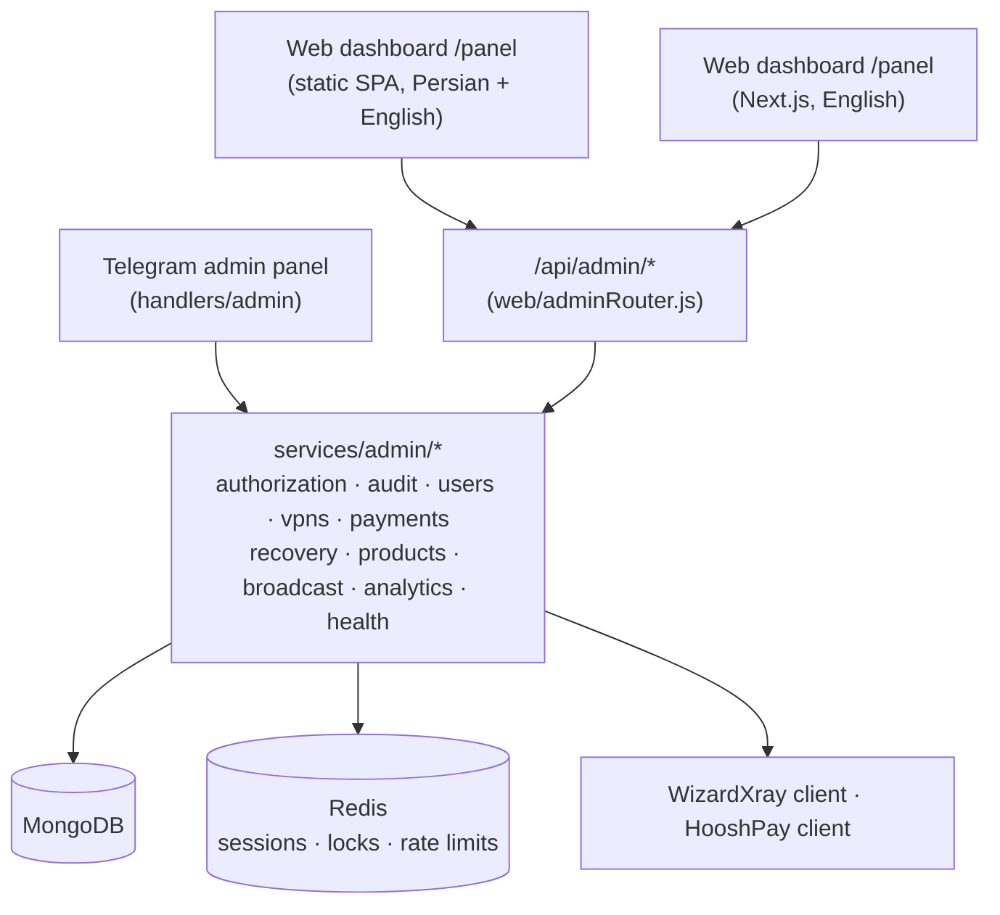

# Admin panel

Admins can work from a Telegram panel or from web dashboards. Both are thin presentations
over the same audited service layer (`services/admin/*`), so authorization, auditing and
business rules are implemented once.

## Access

| Surface | How to open it | Notes |
|---|---|---|
| Telegram panel | Send `/admin`, `/panel`, `پنل` or the **👑 SWIFT ADMIN** button | Allow-listed admins in a private chat, or the admin group (`GROUP_ID`). Every callback is re-authorized on the server |
| Web `/panel` | `<WEBHOOK_BASE_URL>/panel` | Next.js dashboard, English only, light/dark/system theme. Needs `npm run build` (see [storefront and build](storefront.md#build-and-serving)) |
| Legacy static dashboard | `<WEBHOOK_BASE_URL>/index.html` | Original dashboard, Persian (RTL) and English, hash-routed. No longer served at `/panel`: `/admin` redirects (307) to the Next.js `/panel` above (`web/nextAdminMiddleware.js` runs before `web/spa.js`) |

### Web sign-in

1. Enter the Telegram ID of an account listed in `ADMINS` (or added by the owner in the Admins page).
2. The bot sends a one-time code by direct message (valid 5 minutes, single use, stored as SHA-256).
3. The server issues a Redis-backed session: `HttpOnly`, `Secure`, `SameSite=Lax` cookie, a
   double-submit CSRF token, and a lifetime of `ADMIN_SESSION_TTL_SECONDS`.
   The cookie is scoped to `/api/admin` and `/panel` only (never `/`). Signing in again rotates the session. After the move from `/next-panel` to `/panel` a one-time re-login is expected: the old cookie is not sent to `/panel`, and sign-in/sign-out expire it explicitly.

Mutating requests need the session, a valid CSRF token and a same-origin request, and are
rate-limited. Sign-in requests are rate-limited per Telegram ID and per IP.

## What admins can do

| Area | Capabilities |
|---|---|
| Dashboard / analytics | KPIs, revenue/orders/users charts, popular plans, provider and plan breakdowns, CSV export, live system health |
| Users | Search, filters, profile with payments, orders and services. **Credit** or **debit** the wallet, **block / unblock**, **send a Telegram message**, **restore test-service eligibility** (see [User actions](#user-actions)) |
| VPN services | Registry plus live WizardXray detail: change link, enable/disable, revoke, extend time, add traffic |
| Payments | All providers, status tabs, full timeline (wallet debit/refund and webhook events), safe retry, mark for recovery, manual resolve, bank-receipt confirm/reject; NOWPayments orders with an unknown invoice outcome: read-only provider check and an audited, reason-and-confirmation-gated lock release |
| Recovery | Queue of stuck payments and orders, safe retry-all |
| Money Flow Sentinel | Read-only financial monitoring at `/panel/sentinel`: activity overview, live money paths, reconciliation findings with investigation and review, transaction explorer. It moves no money; see [Money Flow Sentinel](sentinel.md) |
| Service reliability | Operations command center at `/panel/reliability`: component health from real evidence, interactive topology, incidents, event timeline, order tracing, history. It reads and reports only; see [Service Reliability Center](reliability.md) |
| Service catalog | `AdminProduct` catalog (delete uses a lock + reference-count handshake with purchases, see `docs/payments.md`), the source of truth for the bot and storefront: paginated search/filter/sort, add, edit (optimistic concurrency via `revision`), duplicate, reorder, put on/off sale (`enabled`), show/hide on storefront (`published`), archive/restore, delete (only if unreferenced and not a shipped plan) |
| Custody | NOWPayments custody balances, conversions, payouts and reconciliation (needs `NOWPAYMENTS_EMAIL` / `NOWPAYMENTS_PASSWORD`) |
| Broadcasts | Preview, audience selection, rate-limited delivery, cancel, progress |
| Admins | Add or remove database admins (owner only) |
| Audit log | Every mutating action with actor, target, reason and IP (web) |
| Mock tests | Run the isolated [mock-test harness](#mock-tests) |
| System health / Settings | Dependency checks; a read-only view of how the server is configured (booleans only — no secret value is ever returned) |

The Telegram panel follows the same sections with confirmations on sensitive actions and
pagination. Long IDs are kept in the chat session and referenced by index so `callback_data`
stays under Telegram's 64-byte limit. It also has TRX wallet scan and balance views,
HooshPay invoice lookup/forced re-fulfillment, API service purchase and messaging a user.

## User actions

- **Credit / debit** use the existing audited, idempotent balance action. The change is an atomic
  `$inc` guarded by an `operationId` ledger (`User.appliedAdminBalanceKeys`), so a repeated
  request never applies twice. A debit is applied only if the balance covers it and can never
  overdraw. The UI confirms before/after balances and reuses the same `operationId` on retry.
- **Send message** delivers one Telegram message to one existing user through the running bot
  (no second bot instance, no token in the browser). Text is HTML-escaped, the result reflects
  Telegram's real answer (`blocked`, `chat not found`, rate-limited, unknown outcome), and the
  audit log stores the length, not the text. It is limited to 3,500 characters and 20 requests/min.
- **Block / unblock** is enforced by the bot: for an admin-blocked user the bot ignores messages,
  button presses and uploads in private chat and replies with a notice. Existing VPN services
  keep working, payments already in flight are still verified and credited by the webhooks,
  admins are never blocked, and users the broadcaster flagged because they blocked the bot are
  not locked out. If the block lookup fails the bot fails open (a moderation tool, not a
  security boundary).
- **Restore test eligibility** clears the "already received a test" state only when no test is
  in flight or awaiting delivery. It never provisions a service.

## Interaction rules

- **Nothing looks successful before the server has answered.** There is no optimistic UI: a success toast follows the
  response, `ChangeFlash` highlights a status or balance only when refreshed server data differs, and
  `ConfirmDialog` stays open with a spinner until the request finishes, keeping a failure inline. Financially sensitive
  actions (bank receipt confirmation, recovery retries, wallet credit and debit) always ask first, and a retry reuses
  its `operationId`.
- **No route loading file under `app/(app)`.** A route loading boundary left filter changes stuck in a transition that never
  committed (about 1 in 16 on Users, 10 in 32 on the catalog) and streamed pages, turning a failed API into HTTP 200.
  `components/shared/navigation-pending.tsx` provides the waiting states instead, and `components/shared/progress-link.tsx`
  gives links outside it (page tabs, the support portal) the same bar; `tests/e2e/nextPanel.e2e.mjs` guards both. `app/(app)/error.tsx` shows a failed page.
- Charts use the green `--chart-*` tokens from `design/theme.css`; a second series is also dashed and legend-keyed; Recharts' own animation follows
  `prefers-reduced-motion` through `lib/use-reduced-motion.ts`.

## Money safety in admin actions

- **Balance changes** use the idempotency ledger above; a replayed request or button cannot
  change a balance twice.
- **Payment retries** call the existing idempotent fulfillment paths (`fulfillHooshOrder`,
  `confirmBankPayment`, scanner phase 2, purchase commit); duplicate webhooks still credit once.
- **Ambiguous provisioning is never replayed.** Manual-review orders are surfaced, not re-created.
- Every mutation writes an `AdminAuditLog` record **before** executing
  (`started` → `succeeded` / `failed`), keyed by a unique `operationId`; the same `operationId`
  replays the stored result instead of repeating the action.

## `/api/admin` reference

All routes except sign-in require a session; mutations also require the CSRF token and are
idempotent through `operationId`. `GET /api/admin/operations/new-id` returns a fresh one.

| Group | Routes |
|---|---|
| Auth | `POST /auth/request-code` · `POST /auth/verify` · `POST /auth/logout` · `GET /auth/session` |
| Overview | `GET /dashboard` · `GET /analytics` · `GET /analytics/report` · `GET /analytics/export.csv` · `GET /system/health` · `GET /settings/overview` · `GET /audit` · `GET /referrals` |
| Users | `GET /users` · `GET /users/:id` · `POST /users/:id/balance` · `/block` · `/unblock` · `/test-eligibility` · `/message` |
| VPN | `GET /vpns` · `GET /vpns/:username` · `POST /vpns/:username/actions` · `GET /vpns-remote/clients` |
| Payments | `GET /payments` · `GET /payments/:key` · `POST /payments/:key/retry` · `/recovery-required` · `/resolve` · `/release-creation-lock` (NOWPayments `creation_unknown` only) · `POST /payments/bank/:id/confirm` · `/reject` |
| Recovery | `GET /recovery` · `POST /recovery/retry-safe` |
| Sentinel | `GET /sentinel/overview` · `/sentinel/sync` · `/sentinel/flow` · `/sentinel/live` · `/sentinel/transactions[/:key]` · `/sentinel/findings[/:id]` · `POST /sentinel/findings/:id/review` · `POST /sentinel/reconcile` |
| Reliability | `GET /reliability/snapshot` · `/reliability/stream` (SSE) · `/reliability/history` · `/reliability/events` · `/reliability/incidents[/:id]` · `/reliability/orders[/:orderId]`. Read-only: no mutating route |
| Service catalog | `GET /products?search&status&duration&sort&order&page&pageSize` · `POST /products` · `PATCH /products/:id` (send `expectedRevision`) · `DELETE /products/:id` · `POST /products/:id/{duplicate,archive,restore,move}` · `POST /products/reorder`. Audit actions: `PRODUCT_CREATED/UPDATED/AVAILABILITY_CHANGED/ARCHIVED/RESTORED/DELETED` |
| Broadcast | `POST /broadcast/preview` · `POST /broadcast` · `GET /broadcast/status/:id` · `POST /broadcast/cancel/:id` · `GET /broadcasts` |
| Custody | `GET /custody/overview` · `/assets` · `/conversions` · `/payouts` · `/payouts/fee` · `/transactions` · `POST /custody/conversions[/preview]` · `/payouts[/validate-address]` · `/payouts/:batchId/verify` · `/reconcile` |
| Admins (owner) | `GET /admins` · `POST /admins` · `DELETE /admins/:telegramId` |
| Mock tests | `GET /mock-tests` · `GET /mock-tests/:runId` · `POST /mock-tests/run` |

## Data stored

New collections: `AdminAuditLog`, `AdminAccount`, `AdminProduct`, `AdminBroadcast`,
`SystemHealth`, `MockTestRun`, `PaymentTombstone`, `SentinelFinding`, `ReliabilityIncident`, `ReliabilityEvent`, `ReliabilityRollup`, plus additive fields on existing models
(wallet debit/refund audit fields on purchases, retry bookkeeping on invoices, activity,
referral and block metadata on `User`). Indexes are created at startup and no destructive
migration runs. Include the new collections in your backups.

## Mock tests

An opt-in harness that runs real payment and provisioning code against in-memory models and
fake providers, so admins can check the flows without touching real money or services.

| Scenario | Real code exercised |
|---|---|
| VPN purchase | catalog, `purchasePlan` reserve/provision/commit, duplicate and concurrent callbacks, insufficient balance, provider rejection → exactly-once refund, timeout/malformed → manual review without replay, failed DB write after provisioning |
| Crypto top-up | catalog validation, `createNowPaymentsTopUp` (in-flight lock, 5xx/4xx/timeout), IPN signature, status state machine, duplicate/concurrent IPNs, amount/underpayment mismatches |
| Card-to-card | `createHooshInvoice`, webhook signature and paid-details validation, two-phase credit, duplicates, crash recovery; bank receipt confirm/reject with audit trail |
| Test service | eligibility, duplicates/concurrency, ineligible users, ambiguous and failed panel results, eligibility reset |

- **Gate:** requires `MOCK_TESTS_ENABLED=true` on the server **and** an allow-listed admin; request
  bodies cannot enable it. Entry points: the admin keyboard button (private chat), the Telegram
  admin panel, and **Mock tests** in the web dashboard.
- **Isolation:** while a run is active, every static query on the real Mongoose models and every
  `http` / `https` / `fetch` request throws and is recorded as an isolation violation (which fails
  the scenario). Customer traffic is unaffected.
- **Separation:** only the report is stored (`MockTestRun`, 90-day TTL); no balance, invoice,
  purchase, revenue or analytics query reads it. The audit log records one `MOCK_TEST_RUN` entry.
- **Statuses:** `PASS` only when assertions ran and all passed; `FAIL` for a failed assertion,
  unexpected error or isolation violation; `BLOCKED` when a precondition is missing; `NOT RUN`
  when disabled or not selected. One run at a time, with a 5-second cool-down.
- **Not verifiable in mock mode:** real provider behaviour, blockchain confirmation,
  WizardXray-side expiry of test services and Telegram delivery.

## Housekeeping job: cancelled and failed invoices

A cron (hourly, first run 60 s after start, guarded by the Redis lease `lock:invoice-cleanup`)
removes invoices that are `cancelled`/`failed` (HooshPay) or `failed` (NOWPayments) **24 hours
after they first entered that state**.

- **Never removed:** pending/creating, paid/finished, partially paid, refunded/reversed, expired,
  anything credited or fulfilled, anything flagged for manual recovery, and NOWPayments invoices
  with funds received.
- **Kept:** a `PaymentTombstone` (provider, order/invoice IDs, user, amount, final status,
  timestamps) is written **before** the delete. Wallet ledgers, purchases and the audit log are
  untouched.
- **Late webhooks** for a removed invoice are acknowledged (200), recorded on the tombstone and
  never credit (HooshPay also alerts admins if it says `paid`).

## Deleting payment records (admin panel)

`Payments` can permanently delete top-up records (HooshPay, NOWPayments, bank, TRX) one by one or
by selection (up to 100). Wallet **orders are never deletable**. `POST /api/admin/payments/delete-preview`
shows the verdict per record; `POST /api/admin/payments/delete` deletes (audited, idempotent per
`operationId`, the confirmed count must equal the selection).

A record qualifies only if it moved no money (not credited/fulfilled, no `paidAt`, tracking code,
transaction hash or amount received, not in the recovery queue) **and** is one of:

| Class | Statuses | Extra condition |
| --- | --- | --- |
| rejected | HooshPay `failed`/`cancelled`; NOWPayments `failed`; bank `rejected`; TRX `rejected` | none |
| stale pending | HooshPay `pending`/`expired`; NOWPayments `creating`/`creation_failed`/`pending`/`waiting`/`expired`; bank `unpaid`/`pending`/`waiting_for_approval`; TRX `unpaid` | older than `ADMIN_PENDING_DELETE_MIN_HOURS` (default 72, minimum 24) and past the provider expiry when stored; bank records with a submitted receipt are excluded |

NOWPayments `confirming`/`confirmed`/`sending`/`partially_paid`/`finished` never qualify.

- The same conditional filter decides eligibility at preview and inside the delete itself, so a
  record whose status changes in between (a webhook marks it paid) is skipped, never removed.
- Preflight is all-or-nothing: one ineligible record blocks the batch and is named.
- A `PaymentTombstone` is written before each delete; wallet ledgers, purchases and the audit log
  are untouched.
- **Late payment after deleting a stale-pending invoice:** HooshPay and NOWPayments callbacks for the
  deleted invoice are acknowledged, recorded on the tombstone and **never credit automatically**; both
  alert the admin group when money was reported. Reconcile such a payment manually. This residual
  risk is why pending records must be old and past their expiry.
- Bank and TRX invoices have no provider callback; deleting an unpaid TRX invoice means a later
  on-chain transfer will not match any invoice and is not credited.

## Known limitations

- VPN **extend time** and **add traffic** follow the provider API (minimum 1 day / 0.5 GB), are
  never auto-retried and report success only when the panel shows the change. There is no
  "regenerate config" method in the provider API v1; use change link.
- Activity and referral tracking start when a user first interacts after the feature shipped;
  older accounts appear on their next interaction. Services registered before purchase tracking
  existed show an unknown expiry until looked up individually.
- **Routes.** `/panel` is the Next.js dashboard. `/next-panel` and `/panel-next` (earlier names) redirect permanently (308) to `/panel`, keeping the sub-path and query. `/admin` redirects temporarily (307) to `/panel`; `/api/admin` is unaffected. The original vanilla-JS dashboard's files are still on disk (`web/public/index.html`, `app.js`, ...) and are still served as `/index.html`; they are scheduled for removal once the database-backed test suites have been run.
- Support tickets live in `/panel/tickets` (admins) and `/panel/support` (customers); see [support](support.md).

## Retrying payments (admin panel / Telegram / recovery batch)

`POST /api/admin/payments/:key/retry` decides what a retry may do **before it writes anything** (`retryPlan` in
`services/admin/payments.js`; the same rule drives the `actions` shown in the payment detail):

| Plan | When | Result | Writes |
| --- | --- | --- | --- |
| settled | the payment is already credited / the order completed with nothing pending | `200 { ok, status, noop: true }` — `already_confirmed` (bank), `already-fulfilled` (HooshPay, TRX), `already_credited` (NOWPayments), `already-completed` (wallet order) | none |
| refuse | the record is not in a state a retry can act on (e.g. HooshPay `failed`, NOWPayments without a provider id, bank not confirmed, TRX unpaid, stalled provisioning) | the established `409` (`payment_not_retryable`, `bank_auto_verify_unavailable`, `non_idempotent_provisioning_blocked`) | none |
| attempt | a genuine recovery step is possible | runs it (balance credits remain idempotent in the payment services) | retry stamp; `recoveryStatus: "required"` only if the attempt really failed |

A retry therefore never credits twice, never touches a settled invoice, and never puts a settled invoice in the recovery
queue. A concurrent "another verification is in progress" (`payment_processing`) is not a recovery failure and is not flagged.
The request itself is always audited. A settled invoice that was flagged by the old behaviour keeps its flag until an admin
uses "resolve".

## Test environment notes

- **MongoDB tests** (the `tests/integration/*` suites that otherwise skip) need a disposable MongoDB:
  `TEST_MONGO_URL=mongodb://127.0.0.1:<port>/swiftvpn_test npm test`. The database name must contain `test`; each test file
  gets its own `swiftvpn_test_<pid>_<random>` database, which `tests/helpers/db.js` drops. Never point it at production.
- **Redis** is needed only by the broadcast concurrency lease (`admin:broadcast:active`). Run those tests against a
  **disposable loopback Redis only**, never a shared or production one, for example
  `redis-server --port 6390 --bind 127.0.0.1 --save "" --appendonly no --dir <temp dir>` (on Windows the portable
  `tporadowski/redis` zip works; no install needed), then
  `REDIS_URL=redis://127.0.0.1:6390 TEST_MONGO_URL=mongodb://127.0.0.1:<port>/swiftvpn_test npm test`.
  `tests/integration/adminServices.test.js` (the broadcast lease test) and `tests/integration/broadcastLease.test.js`
  (held lease, concurrent starts, release) connect the shared client themselves when `REDIS_URL` is set and are reported as
  **skipped, with that reason, when it is not**: a skip means "not verified in this environment", never "passed". A configured
  but unreachable Redis fails loudly instead of skipping.
- **Broadcast lease errors.** Starting a broadcast needs the lease. If Redis is unreachable the request fails closed with
  `503 broadcast_lock_unavailable` (nothing is sent); if another broadcast holds the lease it is `409 broadcast_already_running`.
  Earlier versions reported both as "another broadcast is still running".
