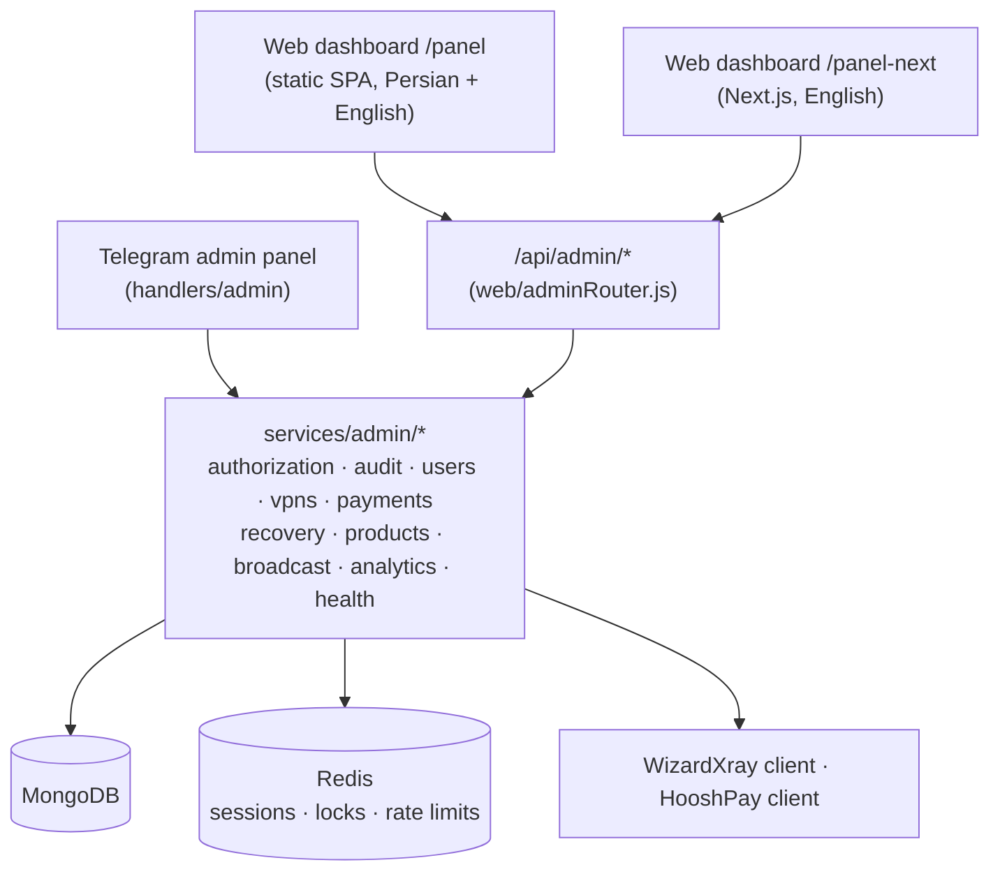

# Admin panel

Admins can work from a Telegram panel or from web dashboards. Both are thin presentations
over the same audited service layer (`services/admin/*`), so authorization, auditing and
business rules are implemented once.

## Access

| Surface | How to open it | Notes |
|---|---|---|
| Telegram panel | Send `/admin`, `/panel`, `پنل` or the **👑 SWIFT ADMIN** button | Allow-listed admins in a private chat, or the admin group (`GROUP_ID`). Every callback is re-authorized on the server |
| Web `/panel-next` | `<WEBHOOK_BASE_URL>/panel-next` | Next.js dashboard, English only, light/dark/system theme. Needs `npm run build` (see [storefront and build](storefront.md#build-and-serving)) |
| Web `/panel` (alias `/admin`) | `<WEBHOOK_BASE_URL>/panel` | Original static dashboard, Persian (RTL) and English, hash-routed |

### Web sign-in

1. Enter the Telegram ID of an account listed in `ADMINS` (or added by the owner in the Admins page).
2. The bot sends a one-time code by direct message (valid 5 minutes, single use, stored as SHA-256).
3. The server issues a Redis-backed session: `HttpOnly`, `Secure`, `SameSite=Lax` cookie, a
   double-submit CSRF token, and a lifetime of `ADMIN_SESSION_TTL_SECONDS`.
   The cookie is scoped to `/api/admin` and `/panel-next` only. Signing in again rotates the session.

Mutating requests need the session, a valid CSRF token and a same-origin request, and are
rate-limited. Sign-in requests are rate-limited per Telegram ID and per IP.

## What admins can do

| Area | Capabilities |
|---|---|
| Dashboard / analytics | KPIs, revenue/orders/users charts, popular plans, provider and plan breakdowns, CSV export, live system health |
| Users | Search, filters, profile with payments, orders and services. **Credit** or **debit** the wallet, **block / unblock**, **send a Telegram message**, **restore test-service eligibility** (see [User actions](#user-actions)) |
| VPN services | Registry plus live WizardXray detail: change link, enable/disable, revoke, extend time, add traffic |
| Payments | All providers, status tabs, full timeline (wallet debit/refund and webhook events), safe retry, mark for recovery, manual resolve, bank-receipt confirm/reject |
| Recovery | Queue of stuck payments and orders, safe retry-all |
| Plans & pricing | `AdminProduct` catalog: create, edit, duplicate, reorder, enable. Used for management and analytics only |
| Custody | NOWPayments custody balances, conversions, payouts and reconciliation (needs `NOWPAYMENTS_EMAIL` / `NOWPAYMENTS_PASSWORD`) |
| Broadcasts | Preview, audience selection, rate-limited delivery, cancel, progress |
| Admins | Add or remove database admins (owner only) |
| Audit log | Every mutating action with actor, target, reason and IP (web) |
| Mock tests | Run the isolated [mock-test harness](#mock-tests) |
| System health / Settings | Dependency checks; a read-only view of how the server is configured (booleans only — no secret value is ever returned) |

The Telegram panel follows the same sections with confirmations on sensitive actions and
pagination. Long IDs are kept in the chat session and referenced by index so `callback_data`
stays under Telegram's 64-byte limit. It also has TRX wallet scan and balance views,
HooshPay invoice lookup/forced re-fulfillment, API service purchase and messaging a user.

## User actions

- **Credit / debit** use the existing audited, idempotent balance action. The change is an atomic
  `$inc` guarded by an `operationId` ledger (`User.appliedAdminBalanceKeys`), so a repeated
  request never applies twice. A debit is applied only if the balance covers it and can never
  overdraw. The UI confirms before/after balances and reuses the same `operationId` on retry.
- **Send message** delivers one Telegram message to one existing user through the running bot
  (no second bot instance, no token in the browser). Text is HTML-escaped, the result reflects
  Telegram's real answer (`blocked`, `chat not found`, rate-limited, unknown outcome), and the
  audit log stores the length, not the text. It is limited to 3,500 characters and 20 requests/min.
- **Block / unblock** is enforced by the bot: for an admin-blocked user the bot ignores messages,
  button presses and uploads in private chat and replies with a notice. Existing VPN services
  keep working, payments already in flight are still verified and credited by the webhooks,
  admins are never blocked, and users the broadcaster flagged because they blocked the bot are
  not locked out. If the block lookup fails the bot fails open (a moderation tool, not a
  security boundary).
- **Restore test eligibility** clears the "already received a test" state only when no test is
  in flight or awaiting delivery. It never provisions a service.

## Money safety in admin actions

- **Balance changes** use the idempotency ledger above; a replayed request or button cannot
  change a balance twice.
- **Payment retries** call the existing idempotent fulfillment paths (`fulfillHooshOrder`,
  `confirmBankPayment`, scanner phase 2, purchase commit); duplicate webhooks still credit once.
- **Ambiguous provisioning is never replayed.** Manual-review orders are surfaced, not re-created.
- Every mutation writes an `AdminAuditLog` record **before** executing
  (`started` → `succeeded` / `failed`), keyed by a unique `operationId`; the same `operationId`
  replays the stored result instead of repeating the action.

## `/api/admin` reference

All routes except sign-in require a session; mutations also require the CSRF token and are
idempotent through `operationId`. `GET /api/admin/operations/new-id` returns a fresh one.

| Group | Routes |
|---|---|
| Auth | `POST /auth/request-code` · `POST /auth/verify` · `POST /auth/logout` · `GET /auth/session` |
| Overview | `GET /dashboard` · `GET /analytics` · `GET /analytics/report` · `GET /analytics/export.csv` · `GET /system/health` · `GET /settings/overview` · `GET /audit` · `GET /referrals` |
| Users | `GET /users` · `GET /users/:id` · `POST /users/:id/balance` · `/block` · `/unblock` · `/test-eligibility` · `/message` |
| VPN | `GET /vpns` · `GET /vpns/:username` · `POST /vpns/:username/actions` · `GET /vpns-remote/clients` |
| Payments | `GET /payments` · `GET /payments/:key` · `POST /payments/:key/retry` · `/recovery-required` · `/resolve` · `POST /payments/bank/:id/confirm` · `/reject` |
| Recovery | `GET /recovery` · `POST /recovery/retry-safe` |
| Plans & pricing | `GET/POST /products` · `PATCH /products/:id` · `POST /products/:id/duplicate` · `POST /products/reorder` |
| Broadcast | `POST /broadcast/preview` · `POST /broadcast` · `GET /broadcast/status/:id` · `POST /broadcast/cancel/:id` · `GET /broadcasts` |
| Custody | `GET /custody/overview` · `/assets` · `/conversions` · `/payouts` · `/payouts/fee` · `/transactions` · `POST /custody/conversions[/preview]` · `/payouts[/validate-address]` · `/payouts/:batchId/verify` · `/reconcile` |
| Admins (owner) | `GET /admins` · `POST /admins` · `DELETE /admins/:telegramId` |
| Mock tests | `GET /mock-tests` · `GET /mock-tests/:runId` · `POST /mock-tests/run` |

## Data stored

New collections: `AdminAuditLog`, `AdminAccount`, `AdminProduct`, `AdminBroadcast`,
`SystemHealth`, `MockTestRun`, `PaymentTombstone`, plus additive fields on existing models
(wallet debit/refund audit fields on purchases, retry bookkeeping on invoices, activity,
referral and block metadata on `User`). Indexes are created at startup and no destructive
migration runs. Include the new collections in your backups.

## Mock tests

An opt-in harness that runs real payment and provisioning code against in-memory models and
fake providers, so admins can check the flows without touching real money or services.

| Scenario | Real code exercised |
|---|---|
| VPN purchase | catalog, `purchasePlan` reserve/provision/commit, duplicate and concurrent callbacks, insufficient balance, provider rejection → exactly-once refund, timeout/malformed → manual review without replay, failed DB write after provisioning |
| Crypto top-up | catalog validation, `createNowPaymentsTopUp` (in-flight lock, 5xx/4xx/timeout), IPN signature, status state machine, duplicate/concurrent IPNs, amount/underpayment mismatches |
| Card-to-card | `createHooshInvoice`, webhook signature and paid-details validation, two-phase credit, duplicates, crash recovery; bank receipt confirm/reject with audit trail |
| Test service | eligibility, duplicates/concurrency, ineligible users, ambiguous and failed panel results, eligibility reset |

- **Gate:** requires `MOCK_TESTS_ENABLED=true` on the server **and** an allow-listed admin; request
  bodies cannot enable it. Entry points: the admin keyboard button (private chat), the Telegram
  admin panel, and **Mock tests** in the web dashboard.
- **Isolation:** while a run is active, every static query on the real Mongoose models and every
  `http` / `https` / `fetch` request throws and is recorded as an isolation violation (which fails
  the scenario). Customer traffic is unaffected.
- **Separation:** only the report is stored (`MockTestRun`, 90-day TTL); no balance, invoice,
  purchase, revenue or analytics query reads it. The audit log records one `MOCK_TEST_RUN` entry.
- **Statuses:** `PASS` only when assertions ran and all passed; `FAIL` for a failed assertion,
  unexpected error or isolation violation; `BLOCKED` when a precondition is missing; `NOT RUN`
  when disabled or not selected. One run at a time, with a 5-second cool-down.
- **Not verifiable in mock mode:** real provider behaviour, blockchain confirmation,
  WizardXray-side expiry of test services and Telegram delivery.

## Housekeeping job: cancelled and failed invoices

A cron (hourly, first run 60 s after start, guarded by the Redis lease `lock:invoice-cleanup`)
removes invoices that are `cancelled`/`failed` (HooshPay) or `failed` (NOWPayments) **24 hours
after they first entered that state**.

- **Never removed:** pending/creating, paid/finished, partially paid, refunded/reversed, expired,
  anything credited or fulfilled, anything flagged for manual recovery, and NOWPayments invoices
  with funds received.
- **Kept:** a `PaymentTombstone` (provider, order/invoice IDs, user, amount, final status,
  timestamps) is written **before** the delete. Wallet ledgers, purchases and the audit log are
  untouched.
- **Late webhooks** for a removed invoice are acknowledged (200), recorded on the tombstone and
  never credit (HooshPay also alerts admins if it says `paid`).

## Known limitations

- VPN **extend time** and **add traffic** follow the provider API (minimum 1 day / 0.5 GB), are
  never auto-retried and report success only when the panel shows the change. There is no
  "regenerate config" method in the provider API v1; use change link.
- Activity and referral tracking start when a user first interacts after the feature shipped;
  older accounts appear on their next interaction. Services registered before purchase tracking
  existed show an unknown expiry until looked up individually.
- The legacy `/panel` and the new `/panel-next` run side by side; both use the same API.
