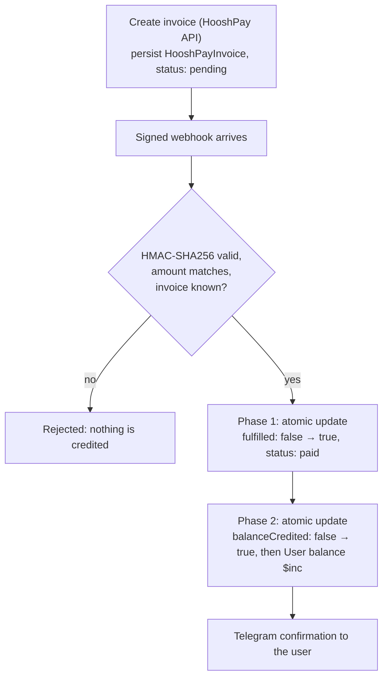
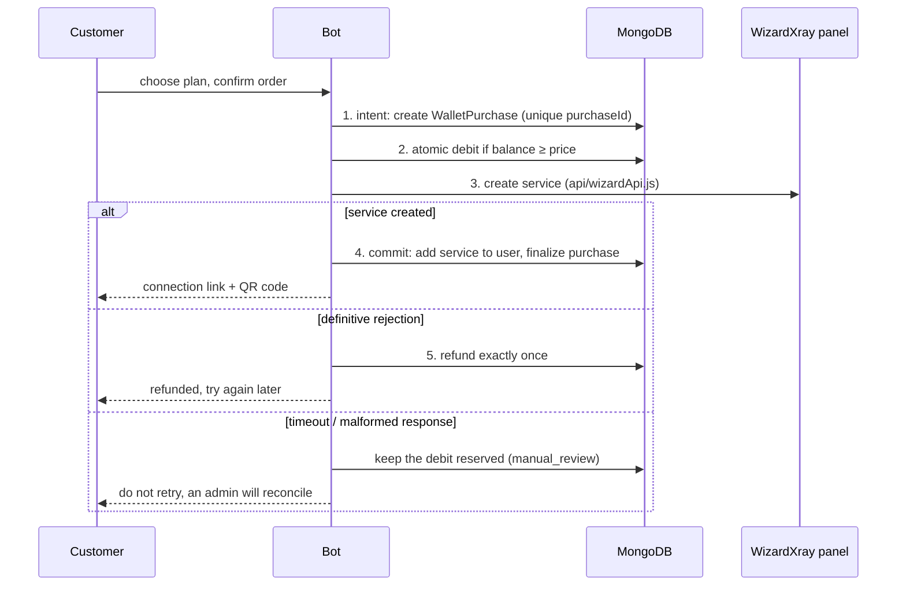

# Payments and money safety

This page describes what happens on every money path and which guarantees the code and the
test suite provide. MongoDB is the only authoritative store for money; Redis is used for
locks and sessions and is never trusted for balances.

- [Wallet top-up methods](#wallet-top-up-methods)
- [HooshPay (automatic)](#hooshpay-automatic)
- [NOWPayments TRON top-up](#nowpayments-tron-top-up)
- [Direct TRX scanner (legacy)](#direct-trx-scanner-legacy)
- [Manual bank transfer (legacy)](#manual-bank-transfer-legacy)
- [Buying a service (wallet → VPN)](#buying-a-service-wallet--vpn)
- [Trial service](#trial-service)

## Wallet top-up methods

| Method | Status | How the wallet is credited |
|---|---|---|
| **HooshPay** — online card-to-card gateway | Offered in the top-up menu | Signed webhook, verified, then a two-phase atomic credit |
| **NOWPayments** — hosted TRON invoice | Offered in the top-up menu | Signature-valid IPN (or authenticated status check) with status `finished` |
| Direct TRX scanner | Legacy: only finishes invoices created before NOWPayments | Background scanner matches on-chain transfers |
| Manual bank transfer with receipt | Legacy: handlers remain, not in the menu; needs `CARD_NUMBER` | Admin confirms the receipt in the admin group |

Top-up amounts are limited to 10,000–50,000,000 Toman by default
([`TOPUP_MIN_TOMAN` / `TOPUP_MAX_TOMAN`](configuration.md#payments-and-pricing)). Amounts are
stored and shown in Toman and are never divided by 10.

## HooshPay (automatic)

- **Idempotent.** Both phases are single atomic MongoDB writes. A duplicate webhook, a double
  click on "I have paid" or a retry loses the race and changes nothing. Ten concurrent
  deliveries credit exactly once.
- **Crash-safe.** A crash between the phases leaves `{fulfilled: true, balanceCredited: false}`.
  The recovery cron completes it on its next cycle (every 5 minutes), exactly once.
- **Redis is not authoritative.** If Redis is down the in-flight lock fails open and the MongoDB
  guards still guarantee a single credit.
- **Rejections never credit:** bad or missing signature, amount mismatch, unknown invoice, or a
  `paid` webhook for an invoice that is already `reversed`.
- **Reversals** (`reversed` / `refunded` / `chargedback`) move `paid → reversed` and alert the
  admin. A later `paid` webhook for a reversed invoice is ignored.
- **Webhook endpoint:** see [Webhooks](deployment.md#webhooks) for the URL, signature rules,
  size and rate limits.

## NOWPayments TRON top-up

New TRON top-ups use a hosted NOWPayments invoice (`pay_currency: trx`).

1. The customer enters a Toman amount and confirms it; then the invoice is created.
2. The USD invoice amount comes from the live Gheymat `USDT-IRT` quote. That API labels `IRT` as
   Toman, so the buy price is **not** divided by 10. Gheymat does not list TRX.
3. A currency estimate (`GET /v1/estimate`) is optional and, when it succeeds, is shown as an
   estimate. The hosted invoice determines the payable TRX amount; if it includes `pay_amount`
   with `pay_currency: trx`, that amount is shown, otherwise the customer is sent to the
   payment page.
4. Creating the invoice does **not** credit the wallet. The wallet is credited only from a
   signature-valid IPN, or a later authenticated status check, when the provider status is
   `finished` **and** the stored fiat amount, currency and TRON ticker match.
5. The credited Toman amount is the amount the customer confirmed, not a later market value.
   Duplicate IPNs credit once (`appliedPaymentKeys`).

A missing, stale or inconsistent quote, an ambiguous create, or any non-`finished` status does
not credit and never invents a rate. A recovery cron re-checks open invoices every 2 minutes.

## Direct TRX scanner (legacy)

Kept only so invoices created before NOWPayments can still be finished. It follows the same
two-phase pattern (`unpaid → paid`, then `balanceCredited`) and adds:

- `transactionHash` is a sparse unique index: one on-chain transaction settles at most one
  invoice; reuse raises `E11000` and is treated as consumed.
- The scanner stops after the first successful match per transaction, so one deposit cannot
  clear several pending invoices.
- Amount matching uses a 1 % tolerance to absorb rate drift between quote and payment.
- The wallet is credited **before** the Telegram notification, so a user is never told "paid"
  for money that was not added.
- The scanner polls TronScan every 5 minutes and repairs `{status: "paid", balanceCredited: false}`
  at the start of each cycle. A Redis lock (`trx:scan:cron`) prevents overlapping runs.

## Manual bank transfer (legacy)

A receipt photo is posted to the admin group with a **Confirm** button.

- **Admin-only.** The callback re-checks that the clicker is in `ADMINS` **and** in `GROUP_ID`;
  buttons on a forwarded message still deliver callbacks, so identity is never inferred from
  the button.
- **Single credit.** Confirmation is an atomic
  `findOneAndUpdate({ paymentId, status: { $ne: "confirmed" } })`; a double click or replayed
  callback credits once.
- **The amount comes from the database**, never from `callback_data`.

## Buying a service (wallet → VPN)

Customer plans are defined only in `customerPlans` in [`services/plans.js`](../services/plans.js):
four durations (30, 90, 180 and 365 days), each with several traffic tiers (10–500 GB), with a
fixed Toman selling price per plan. The request cannot set price, duration or traffic; the
server resolves the plan ID again at charge time. The admin "Plans & pricing"
(`AdminProduct`) collection powers management and analytics only and cannot change what a
customer pays.

- **Concurrency-safe wallet.** MongoDB applies the sufficient-balance check and the debit in one
  update, so simultaneous orders cannot spend the same balance or make it negative. A payment
  credit arriving during checkout is preserved by `$inc`.
- **Idempotent order identity.** `purchaseId` is unique and keys the reservation, the service
  commit and the refund. Telegram derives it from the confirmation message, so a replayed
  callback cannot create a second service. Other callers must reuse the same ID when retrying
  the same purchase.
- **Exactly-once refund.** `refund_pending` is persisted before the wallet credit;
  `User.refundedPurchaseIds` and the atomic increment prevent duplicate refunds. The purchase
  row records the original price, refund amount and reason, timestamps, customer, plan and
  provider service.
- **Definitive failures** (insufficient panel balance and other explicit API rejections) refund
  the customer. The raw provider response is not stored or shown to customers; only a coarse
  internal error code is kept.
- **Ambiguous create results** (timeout, unavailable panel, malformed response) are never
  blindly retried and never marked fulfilled. The debit stays reserved in a recoverable
  `manual_review` state until the result can be reconciled, and the customer is told not to
  retry. Orders in manual review are surfaced to admins, never re-created.
- **Crash recovery.** Recovery jobs refund a reservation that never reached the provider,
  finish a durable successful response, or hold an ambiguous in-flight request without calling
  WizardXray create again.

## Trial service

Each Telegram account can receive one free trial service. Eligibility is stored on the user
(`hasReceivedTest`, `testServiceStatus`); concurrent or repeated requests, ineligible users and
ambiguous panel results are handled without creating a second service. An admin can restore
eligibility for a user with an audited action; this restores the right to request one more
trial and never provisions anything by itself.
