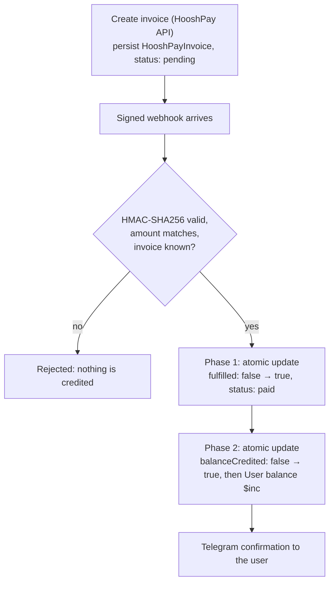
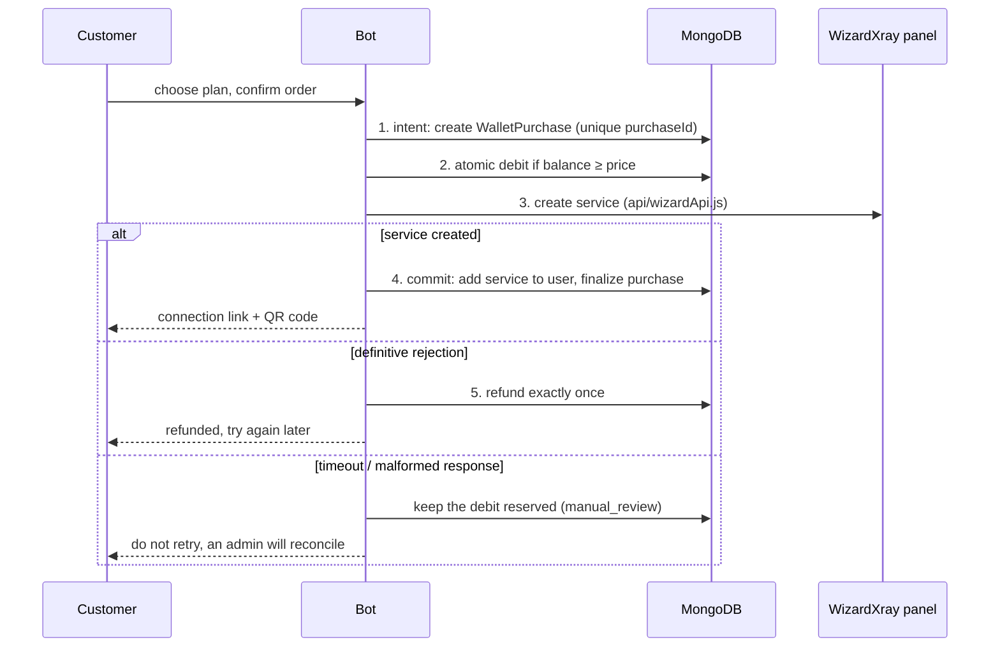

# Payments and money safety

This page describes what happens on every money path and which guarantees the code and the
test suite provide. MongoDB is the only authoritative store for money; Redis is used for
locks and sessions and is never trusted for balances.

- [Wallet top-up methods](#wallet-top-up-methods)
- [HooshPay (automatic)](#hooshpay-automatic)
- [NOWPayments TRON top-up](#nowpayments-tron-top-up)
- [Direct TRX scanner (legacy)](#direct-trx-scanner-legacy)
- [Manual bank transfer (legacy)](#manual-bank-transfer-legacy)
- [Buying a service (wallet → VPN)](#buying-a-service-wallet--vpn)
- [Trial service](#trial-service)

## Wallet top-up methods

| Method | Status | How the wallet is credited |
|---|---|---|
| **HooshPay** — online card-to-card gateway | Offered in the top-up menu | Signed webhook, verified, then a two-phase atomic credit |
| **NOWPayments** — hosted TRON invoice | Offered in the top-up menu | Signature-valid IPN (or authenticated status check) with status `finished` |
| Direct TRX scanner | Legacy: only finishes invoices created before NOWPayments | Background scanner matches on-chain transfers |
| Manual bank transfer with receipt | Legacy: handlers remain, not in the menu; needs `CARD_NUMBER` | Admin confirms the receipt in the admin group |

Top-up amounts are limited to 10,000–50,000,000 Toman by default
([`TOPUP_MIN_TOMAN` / `TOPUP_MAX_TOMAN`](configuration.md#payments-and-pricing)). Amounts are
stored and shown in Toman and are never divided by 10.

## HooshPay (automatic)

- **Idempotent.** Both phases are single atomic MongoDB writes. A duplicate webhook, a double
  click on "I have paid" or a retry loses the race and changes nothing. Ten concurrent
  deliveries credit exactly once.
- **Crash-safe.** A crash between the phases leaves `{fulfilled: true, balanceCredited: false}`.
  The recovery cron completes it on its next cycle (every 5 minutes), exactly once.
- **Redis is not authoritative.** If Redis is down the in-flight lock fails open and the MongoDB
  guards still guarantee a single credit.
- **Rejections never credit:** bad or missing signature, amount mismatch, unknown invoice, or a
  `paid` webhook for an invoice that is already `reversed`.
- **Reversals** (`reversed` / `refunded` / `chargedback`) move `paid → reversed` and alert the
  admin. A later `paid` webhook for a reversed invoice is ignored.
- **Webhook endpoint:** see [Webhooks](deployment.md#webhooks) for the URL, signature rules,
  size and rate limits.

## NOWPayments TRON top-up

New TRON top-ups use a hosted NOWPayments invoice (`pay_currency: trx`).

1. The customer enters a Toman amount and confirms it; then the invoice is created.
2. The USD invoice amount comes from the live Gheymat `USDT-IRT` quote. That API labels `IRT` as
   Toman, so the buy price is **not** divided by 10. Gheymat does not list TRX.
3. A currency estimate (`GET /v1/estimate`) is optional and, when it succeeds, is shown as an
   estimate. The hosted invoice determines the payable TRX amount; if it includes `pay_amount`
   with `pay_currency: trx`, that amount is shown, otherwise the customer is sent to the
   payment page.
4. Creating the invoice does **not** credit the wallet. The wallet is credited only from a
   signature-valid IPN, or a later authenticated status check, when the provider status is
   `finished` **and** the stored fiat amount, currency and TRON ticker match.
5. The credited Toman amount is the amount the customer confirmed, not a later market value.
   Duplicate IPNs credit once (`appliedPaymentKeys`).

### Which currencies are offered, and the minimum amount

- **Allowlist (at most 10 choices).** Customers can only pick what is listed in
  [`services/nowpayments/allowlist.js`](../services/nowpayments/allowlist.js) **and** enabled for
  the merchant account right now (`GET /v1/merchant/coins`, cross-checked with `GET /v1/currencies`).
  Each network of a token is its own entry with its own provider code (`usdttrc20` ≠ `usdtbsc`).
  If the merchant list cannot be read, or nothing in the allowlist is enabled, the menu is empty and
  creation is refused; the full provider list is never shown as a fallback. Invoice creation re-checks
  the allowlist, network and ticker server-side, so a hand-crafted callback cannot pick another coin.
  Run `node scripts/verify-nowpayments-allowlist.mjs` (read-only, needs `NOWPAYMENTS_API_KEY`) to see
  what the live account accepts and the provider's current minimums before editing the list.
- **Minimum amount.** Before a quote is issued, and again before `POST /invoice` when the quote did
  not carry it, the bot asks `GET /v1/min-amount?currency_from=<code>&currency_to=<outcome>&fiat_equivalent=usd`
  (plus the same `is_fixed_rate` / `is_fee_paid_by_user` flags as the invoice) and compares
  the invoice price (Toman ÷ the Gheymat rate, in cents) with the returned `fiat_equivalent`. Below the
  minimum the customer is told the minimum in Toman and no invoice is created; the entered amount is never
  raised. If the lookup fails or is unusable, no quote or invoice is produced (fail closed). There is no
  hard-coded crypto minimum; `TOPUP_MIN_TOMAN` remains the only static floor. `<outcome>` is the pay currency
  itself unless `NOWPAYMENTS_MIN_AMOUNT_CURRENCY_TO` names the coin your account settles to (set it if the
  account auto-converts; the bot logs `outcome_pair_differs` when an invoice reports another payout currency).
- **Hosted URL.** `invoice_url` must be an `https` NOWPayments URL with a path (a bare host cannot be an
  invoice page). The reference shows `https://nowpayments.io/payment/?iid=<id>` but does not promise that
  `iid` equals the invoice `id`, so a different `iid` is delivered unchanged and only logged
  (`iid_differs_from_invoice_id`). An unusable URL is withheld and the order is parked as `creation_unknown`
  with the provider invoice id. If the invoice exists remotely but the local write fails, the same parking
  applies (`persistence_failed`). Whether the hosted page renders is a provider-side fact the bot cannot
  verify: `scripts/sandbox-invoice-check.mjs` (owner-run, sandbox only) creates one below-minimum and one
  above-minimum sandbox invoice to open in a browser.
- **Safety margin.** The reference documents no tolerance between the `/min-amount` figure and what the
  hosted page accepts, and (without `is_fixed_rate`) the pay amount is computed later at the live rate, so an
  amount equal to the minimum can end up below it. `NOWPAYMENTS_MIN_AMOUNT_MARGIN_PERCENT` (0–100, default
  **0**) raises the required price by that percentage. It is off by default because no value can be justified
  from provider documentation; calibrate it with the sandbox check or set `NOWPAYMENTS_FIXED_RATE=true`
  (the rate is then frozen for the invoice).
- **Late payments.** A verified `finished` IPN for an order already `expired`, `failed` or `refunded` is not
  credited but sets `recoveryReason: payment_after_terminal_status` for admin review.

### Orders whose invoice outcome is unknown (`creation_unknown`)

A timed-out or half-recorded `POST /invoice` leaves the order in `creation_unknown`. While it exists the
customer cannot open another crypto invoice (`in_flight`; the status check and the unique `openCreateKey` both
enforce it), so a second invoice can never be created for an unresolved first one.

| Step | What happens | Money / lock |
|---|---|---|
| Signed IPN | Verified like any other (order, invoice, amount, currency, crypto amount). A provider-bound status moves the order off `creation_unknown` and frees the key | credits only on a verified `finished`, once |
| Recovery lookup (every 2 min, needs `NOWPAYMENTS_EMAIL` / `NOWPAYMENTS_PASSWORD`) | `GET /v1/payment/` filtered by the recorded `invoiceId` (or by a date window and `order_id` when none was recorded). Exactly one matching payment is handed to the normal verifier; none, several, truncated pages, mismatching ids, or any provider failure change nothing and back off 10 min | never credits by itself; never releases the lock |
| Admin retry | Same read-only lookup, on demand | same |
| Admin **release** (`POST /payments/:key/release-creation-lock`, audited) | Only for an uncredited, payment-less order older than 10 min, after a fresh lookup finds nothing (or, if the lookup is impossible, with an explicit `acceptUnverified`). One compare-and-set to `creation_failed`, clearing both lock mechanisms | no money moves; a later signed payment for it is flagged `ipn_after_rejected_create`, never auto-credited |

**What the lookup can and cannot establish.** The official reference has no "get invoice" endpoint, so the lookup can
prove that a payment exists but never that an unpaid invoice does not. In `GET /v1/payment/` the documented
correlation keys are `invoice_id` (and the `invoiceId` filter). `order_id` is in the response schema but every
documented sample has it `null`, so it is **not assumed to be returned**:

- a payment carrying our `invoice_id` **and** an `order_id` equal to ours is settled by the normal verifier;
- our `invoice_id` with a missing/null `order_id` is **held** (`provider_lookup_unconfirmed`, with the payment id) and
  blocks the release; our invoice under another order id, several payments, a result truncated at the page limit, or
  paging that does not advance are likewise held (`ambiguous` / `mismatch`);
- with **no recorded invoice id** only `order_id` is left, so an empty result is *not* verification
  (`no_payment_found_unverifiable`) and a release then always needs the written confirmation;
- authentication failures, HTTP errors, timeouts and malformed bodies are "unavailable": nothing changes, back-off,
  and a release needs the written confirmation.

None of these outcomes ever releases the lock. Releasing is a human decision and the generic "resolve" action refuses
these orders (`use_creation_lock_release`). Because the customer never received the link in these cases, a payment
for the abandoned invoice is unlikely; if one arrives after a release it is held for review, an administrator is
alerted once in the admin group, and nothing is credited automatically.

**Admin panel.** Payments → the order → *Check provider (read-only)* runs the lookup. *Release create-lock…* needs a reason
of 10–400 characters; the server looks the order up first. If it cannot verify absence, the dialog asks for an explicit
tick ("I checked this invoice in the NOWPayments dashboard and confirm that no payment exists") before
*Release without provider verification* is enabled. Every attempt is audited with the administrator's identity, the
attestation flag and an order reference (the audit log redacts long ids, so the last 12 characters are stored). The
generic "Mark resolved" button is not offered for these orders.

A missing, stale or inconsistent quote, an ambiguous create, or any non-`finished` status does
not credit and never invents a rate. A recovery cron re-checks open invoices every 2 minutes.

## Direct TRX scanner (legacy)

Kept only so invoices created before NOWPayments can still be finished. It follows the same
two-phase pattern (`unpaid → paid`, then `balanceCredited`) and adds:

- `transactionHash` is a sparse unique index: one on-chain transaction settles at most one
  invoice; reuse raises `E11000` and is treated as consumed.
- The scanner stops after the first successful match per transaction, so one deposit cannot
  clear several pending invoices.
- Amount matching uses a 1 % tolerance to absorb rate drift between quote and payment.
- The wallet is credited **before** the Telegram notification, so a user is never told "paid"
  for money that was not added.
- The scanner polls TronScan every 5 minutes and repairs `{status: "paid", balanceCredited: false}`
  at the start of each cycle. A Redis lock (`trx:scan:cron`) prevents overlapping runs.

## Manual bank transfer (legacy)

A receipt photo is posted to the admin group with a **Confirm** button.

- **Admin-only.** The callback re-checks that the clicker is in `ADMINS` **and** in `GROUP_ID`;
  buttons on a forwarded message still deliver callbacks, so identity is never inferred from
  the button.
- **Single credit.** Confirmation is an atomic
  `findOneAndUpdate({ paymentId, status: { $ne: "confirmed" } })`; a double click or replayed
  callback credits once.
- **The amount comes from the database**, never from `callback_data`.

## Buying a service (wallet → VPN)

Customer plans come from the admin **Service catalog** (`AdminProduct` collection), seeded at boot from the
shipped `customerPlans` in [`services/plans.js`](../services/plans.js): four fixed durations (30, 90, 180 and
365 days), each with several traffic tiers. A product is sellable only when it is enabled, not archived and uses a
supported duration. The request cannot set price, duration or traffic; the server resolves the plan ID again
(`getSellablePlanById`) at confirmation, charge and crypto-quote time, so disabled/archived plans cannot be bought
from stale menus. Orders snapshot name, volume, days and amount, so later edits never rewrite history. The shipped
catalog is only a fallback when the collection is empty, or for *display* listings when the database is unreachable.
Authorization (Telegram confirm step, wallet purchase, crypto quote) passes `requireDatabase` and fails closed: a
database error or missing connection rejects the purchase (`CATALOG_UNAVAILABLE`) and nothing is created or debited.
Storefront deep links and `/api/store/plans/:id` are advisory hand-offs; the bot re-validates at confirm and charge.

Permanent product deletion is coordinated with order creation: the delete first sets `deleteLockedAt` (which makes
every purchase lookup refuse the plan), then counts references, then deletes only while the lock is held. A purchase
re-checks the product (`isProductReferencable`) right after its order record exists and withdraws the not-yet-debited
order if the product is locked or gone. NOWPayments invoices carry `planId` only as informational metadata (no
fulfillment reads it), so they are counted as references but not part of the handshake.

- **Concurrency-safe wallet.** MongoDB applies the sufficient-balance check and the debit in one
  update, so simultaneous orders cannot spend the same balance or make it negative. A payment
  credit arriving during checkout is preserved by `$inc`.
- **Idempotent order identity.** `purchaseId` is unique and keys the reservation, the service
  commit and the refund. Telegram derives it from the confirmation message, so a replayed
  callback cannot create a second service. Other callers must reuse the same ID when retrying
  the same purchase.
- **Exactly-once refund.** `refund_pending` is persisted before the wallet credit;
  `User.refundedPurchaseIds` and the atomic increment prevent duplicate refunds. The purchase
  row records the original price, refund amount and reason, timestamps, customer, plan and
  provider service.
- **Definitive failures** (insufficient panel balance and other explicit API rejections) refund
  the customer. The raw provider response is not stored or shown to customers; only a coarse
  internal error code is kept.
- **Ambiguous create results** (timeout, unavailable panel, malformed response) are never
  blindly retried and never marked fulfilled. The debit stays reserved in a recoverable
  `manual_review` state until the result can be reconciled, and the customer is told not to
  retry. Orders in manual review are surfaced to admins, never re-created.
- **Crash recovery.** Recovery jobs refund a reservation that never reached the provider,
  finish a durable successful response, or hold an ambiguous in-flight request without calling
  WizardXray create again.

## Trial service

Each Telegram account can receive one free trial service. Eligibility is stored on the user
(`hasReceivedTest`, `testServiceStatus`); concurrent or repeated requests, ineligible users and
ambiguous panel results are handled without creating a second service. An admin can restore
eligibility for a user with an audited action; this restores the right to request one more
trial and never provisions anything by itself.
